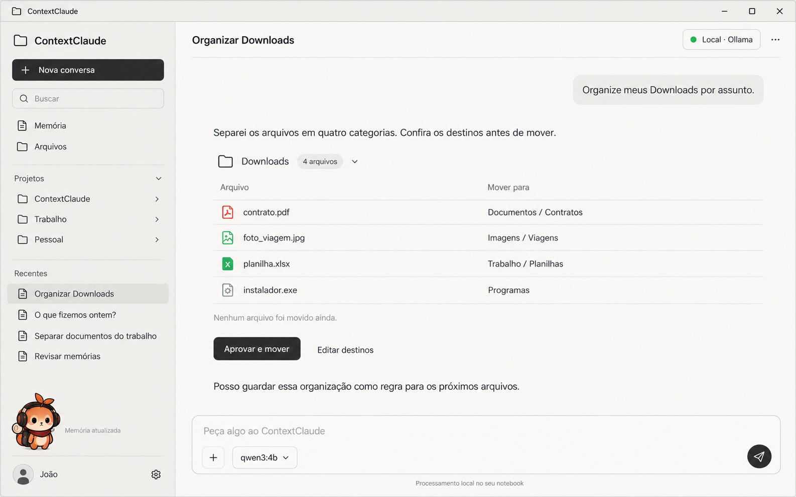

# ContextClaude

Memória local e permanente para o [Claude Code](https://claude.com/claude-code) — um mascote de mesa que anota o que acontece em cada sessão, sem gastar um único token da API.

<p align="center">
  
</p>

## O que é

Quando uma sessão do Claude Code termina, um modelo local (Qwen3 4B via [Ollama](https://ollama.com)) lê a transcrição e extrai fatos, decisões, pendências e relações entre entidades — tudo isso roda na sua máquina, sem chamar a API da Anthropic. O resultado vira:

- **SQLite** — fila de processamento, fatos com histórico de status (confirmado / substituído) e um grafo leve de relações.
- **Vault do Obsidian** — uma pasta por projeto, com notas de sessão em Markdown e `[[wikilinks]]` entre entidades.
- **ChromaDB** — índice vetorial para busca semântica (`cc.py buscar`).
- **App desktop** — janela nativa (pywebview) com chat sobre a sua memória, organizador de pastas e o mascote chibi dentro do app, com um log simplificado do que está sendo anotado. Abra com `python src/cc.py app`; `python src/cc.py atalho` cria os atalhos no Menu Iniciar e na Área de Trabalho.

Hooks do próprio Claude Code (`SessionStart` / `SessionEnd`) disparam a captura; o processamento pesado roda num worker separado, para não atrasar a abertura de uma sessão.

## Arquitetura

```
Claude Code (hooks) → fila (SQLite) → worker → Ollama (Qwen3 4B)
                                          │
                        ┌─────────────────┼─────────────────┐
                        ▼                 ▼                 ▼
                     SQLite           Vault Obsidian      ChromaDB
                 (fatos/relações)   (notas por projeto)  (busca semântica)
```

- **Zero tokens do Claude** na captura e no processamento — só o modelo local é chamado.
- **Uma pasta por projeto**, derivada do diretório onde o Claude Code foi aberto.
- **Recall opcional**: projetos marcados recebem um resumo curto injetado no início da próxima sessão.
- **Evolução em camadas**: SQLite+Obsidian (fase 1) → ChromaDB (fase 2) → grafo de conhecimento (fase 3).

## CLI

```
python src/cc.py buscar "<consulta>" [-p projeto] [-n 5]   # busca semântica
python src/cc.py grafo <entidade> [-p projeto] [-d 2]       # vizinhos no grafo
python src/cc.py indexar                                    # reconstrói o índice vetorial
python src/cc.py vault -p <projeto>                          # reconstrói as notas do Obsidian a partir do SQLite
```

## Stack

Python 3.13 · SQLite · ChromaDB · Ollama (Qwen3 4B) · pywebview · Obsidian (vault é só Markdown — o app é opcional)

## Documentação

- [`docs/design.md`](docs/design.md) — desenho da Fase 1 (captura e armazenamento)
- [`docs/design-fase2.md`](docs/design-fase2.md) — busca semântica com ChromaDB
- [`docs/design-app.md`](docs/design-app.md) — o app desktop
- [`docs/design-fase3.md`](docs/design-fase3.md) — grafo de conhecimento
- [`docs/superpowers/`](docs/superpowers) — specs e planos de implementação de cada fase

## Testes

```
pip install -r requirements.txt
python -m pytest tests/ -q
```

---

Projeto pessoal, construído em pares com o Claude Code.
